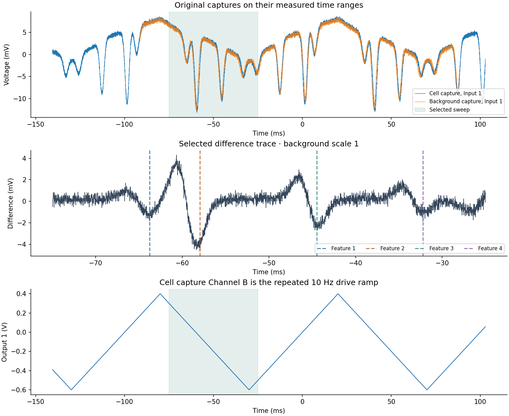
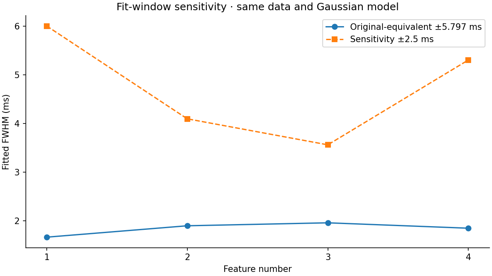

# Analysis review

The original calculations are numerically reproducible. Their physical interpretation needs additional experimental evidence. This review separates file-level observations, numerical diagnostics and assumptions.

## Channel mapping and the background

The cell file `MokuOscilloscopeData_20251029_144859_HighRes.csv` maps **Channel A to Input 1** and **Channel B to Output 1**, the drive ramp. The selected background file `back100offset10hz_20251029_150846_HighRes.csv` maps **Channel A to Input 2** and **Channel B to Input 1**. Subtracting background Channel B therefore follows the notebook and uses the same input number, rather than subtracting the drive ramp.

The notebook describes the latter capture as having no cell. Its Input 1 trace visibly contains a similar family of dips, so that experimental designation cannot be established from the files alone. The new plot shows both measured traces and their difference. Positive/negative lobes could reflect scan misalignment or changed line shape; the files do not establish a unique cause. A Gaussian fit to the difference is not automatically the Doppler linewidth of the original absorption.

Background coverage is **-91.44408 to 88.45658 ms**. The original `np.interp` silently holds endpoint values for **4,263** cell samples outside that range. The portable fit uses only the covered selected sweep; interpolation outside measured coverage raises an error. This preserves the selected fit data while avoiding artificial full-trace tails.

## Frequency conversion

The cell CSV spans **243.47948 ms**, while its settings specify a 10 Hz, 1 Vpp, 50% symmetric triangular drive. One monotonic half-period is 50 ms. The notebook assigns one assumed **33.6 GHz** span to the full **243.47948 ms** record, producing **137.999309 MHz/ms** even though the record contains multiple sweep reversals.

A linear fit to the measured drive from −70 to −30 ms gives **-0.020000004 V/ms**, consistent with 1 V over 50 ms. If the missing tuning curve really supplies 33.6 GHz per volt at the same drive point, the conditional slope magnitude would be about **672 MHz/ms**, a factor of **4.86959** above the historical time mapping. This dimensional check is not a replacement calibration: the tuning-curve definition, instrument termination, voltage transfer and scan linearity still need verification.

The portable fit operates directly in milliseconds. Its half-window is derived once from the historical window, `0.8 GHz / (33.6 GHz / 243.47948 ms)`, to compare like with like. `historical_mapping_fwhm_MHz` in the JSON is explicitly a reproduction diagnostic; accepted MHz widths remain null. No absolute frequency reference or transition identification is inferred.

## Gaussian fit and window sensitivity

The model is `offset + amplitude × exp(−4 ln(2) ((t − centre)/FWHM)²)`, with negative amplitude and positive FWHM. The four-segment minimum heuristic is preserved, and boundary minima now trigger a review error. It assumes four features in the chosen interval; it is not an independent peak-count or transition-identification algorithm.

The broad original-equivalent windows include adjacent or opposite-polarity structure. Residuals are visibly systematic. A narrower **±2.5 ms** window gives the following diagnostic:

| Feature | Main FWHM (ms) | Narrow-window FWHM (ms) | Change | Narrow fit covers both half maxima |
| --- | ---: | ---: | ---: | --- |
| 1 | 1.6596 | 6.0044 | +261.8% | no |
| 2 | 1.8939 | 4.0944 | +116.2% | yes |
| 3 | 1.9549 | 3.5595 | +82.1% | yes |
| 4 | 1.8438 | 5.3047 | +187.7% | no |

The large changes show that these widths are sensitive to the model and selected region. Narrow-window fits that extend beyond their half-maximum coverage should not be adopted as improved estimates. Residual-scaled covariance errors assume a locally appropriate least-squares model and do not include background, correlated-noise or calibration uncertainty. [SciPy curve_fit documentation](https://docs.scipy.org/doc/scipy/reference/generated/scipy.optimize.curve_fit.html).

## Transmission, density and pressure

The historical density section uses a different, wider interval (**−75 to +25 ms**) to select the deepest difference dip. At **-57.97912 ms**, the original cell voltage is **-5.633333 mV**, and the chosen 95th-percentile baseline is **7.533333 mV**. Their ratio is **-0.747788**, which cannot be a positive optical transmission.

The original code adds an arbitrary offset based on the minimum of the whole region, uses its shifted maximum as the reference, and clamps the resulting ratio if needed. That arithmetic reproduces the report, but it does not measure the detector's dark offset. Additive shifts change the intensity ratio and therefore change the Beer–Lambert inference. The portable diagnostic preserves the invalid raw ratio and returns no density or pressure.

The archived cross-section `3 × 10⁻¹³ m²`, temperature `293 K` and cell length `0.075 m` are notebook assumptions. Their experimental applicability is not established by this payload. A line-centre cross-section depends on the transition, broadening and populations, so an order-of-magnitude resonant value cannot be adopted without justification for the observed thermal feature. [Steck's rubidium reference](https://steck.us/alkalidata/rubidium85numbers.pdf) describes the transition-dependent absorption cross-section and relevant atomic parameters.

## Report context

The report uses an approximate 380 THz frequency to estimate roughly 790 nm and a single-atom Doppler shift of about 300 MHz. That shift is not the FWHM of a thermal Doppler distribution. Rubidium's D2 transition is near 780 nm; the exact transition and frequency reference must be specified before comparing a thermal width with fitted data. [Rubidium 85 D Line Data](https://steck.us/alkalidata/rubidium85numbers.pdf).

The original Word file and notebook outputs are preserved, including their historical conclusions and figure formatting. The newer review and plots are separate additions.
