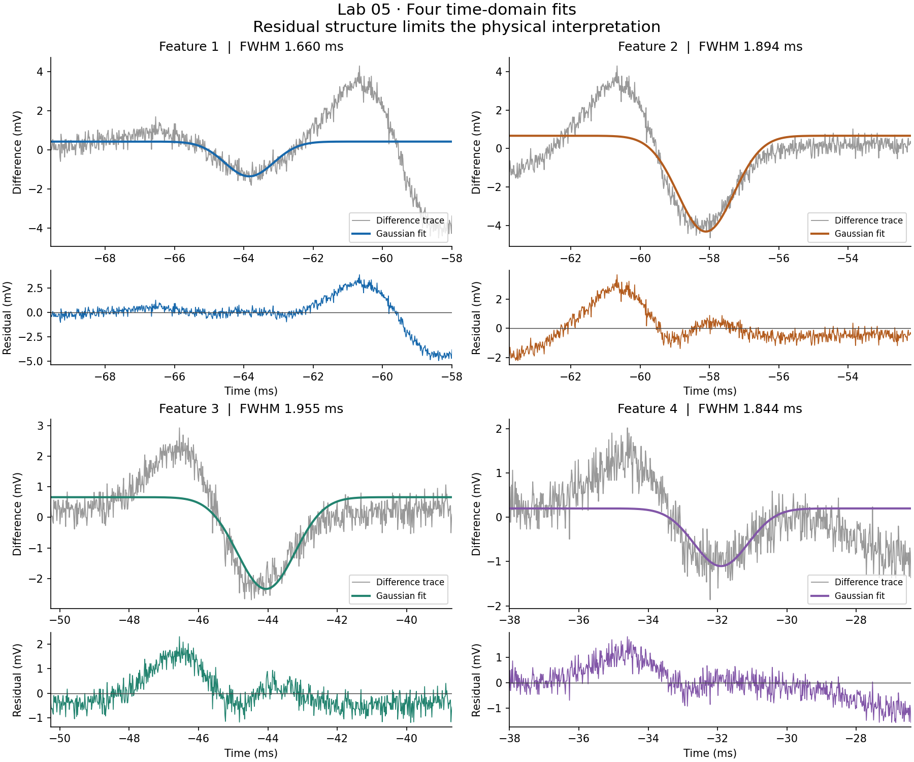

# Doppler-Broadened Rubidium Absorption

**Lab 05 · York University · Siddharth Prajapati**

A reproducible study of rubidium absorption data: import oscilloscope exports, compare a signal and background capture, fit four difference features, and test how the chosen window affects the result.

**Status:** all 25 files from the supplied ZIP, the original report, and an archived notebook are included. Both original calculation cells have been rerun. A portable Python workflow produces time-domain fits, residuals and a fit-window sensitivity comparison, with ten passing numerical tests.



The report credits ChatGPT 5.1 Extended Thinking with generating the original code. This project documents **AI-assisted experimental analysis**, including the later refactor and its limitations. [Provenance](PROVENANCE.md) records the changes.

## What the code demonstrates

- Reading instrument CSVs while retaining their units and channel meanings.
- Interpolating a separate capture without extending beyond its measured coverage.
- Selecting features and fitting bounded nonlinear models.
- Inspecting residuals, conditional uncertainty and fit-window sensitivity.
- Auditing frequency conversion and rejecting an invalid voltage ratio.
- Producing reproducible plots, CSV summaries and source hashes from a command-line program.

## Time-domain results

The workflow uses the original **−75 to −25 ms** selection, manual background scale **1**, and a fit half-window of **5.797130 ms**, equivalent to the notebook's original window. These are Gaussian fits to the **difference trace**.

| Feature | Fitted centre (ms) | FWHM (ms) | Conditional standard error (ms) |
| --- | ---: | ---: | ---: |
| 1 | -63.8455 | 1.659612 | 0.260293 |
| 2 | -58.1044 | 1.893932 | 0.068561 |
| 3 | -44.0529 | 1.954859 | 0.069743 |
| 4 | -31.8993 | 1.843826 | 0.145857 |

These time widths reproduce the original method to within 0.01%; small differences result from parameter bounds, voltage normalization and tighter optimizer tolerances. The original code itself reproduces its saved output. The quoted errors reflect the fitted covariance only and do not cover background, calibration or model errors.

**The physical linewidths remain unverified.** The subtraction leaves substantial positive and negative structure, and reducing the half-window to 2.5 ms changes fitted widths by **82–262%**. Some narrower-window fits extend beyond their fitted half-maximum coverage. These are sensitivity diagnostics, not improved width estimates. The background capture also has dips resembling the cell capture; its experimental role needs confirmation.

The historical frequency scale uses a multi-sweep recording as one scan. The density calculation starts with a negative raw voltage ratio, then shifts and clamps it. The portable output leaves frequency linewidths, optical transmission, number density and pressure unaccepted. See [the analysis review](ANALYSIS_REVIEW.md).

## Browse the project

| Item | Contents |
| --- | --- |
| [Python analysis](src/analyze.py) | Validated input handling, Gaussian fits and diagnostics |
| [Analysis notebook](notebooks/analysis.ipynb) | Runs the same portable workflow |
| [Archived notebook](notebooks/lab5-archived.ipynb) | Original numerical logic and cached plots, with portable input paths |
| [Original report](reports/lab5-original-report.docx) | Unmodified report, including original results and attribution |
| [Input guide](data/README.md) | Channel mapping, capture inventory and file hashes |
| [Configuration](config/analysis.json) | Inputs, windows and historical assumptions |
| [Fresh results](results/reproduced/) | JSON summary, fit tables, residual CSVs and three plots |
| [Historical reproduction](results/archived/) | Output of the original calculation, clearly labelled |
| [Numerical tests](tests/test_analysis.py) | Ten tests with explicitly synthetic inputs |

## Run

From the repository root, in a Python virtual environment:

```bash
python -m pip install -r projects/rubidium-absorption/requirements.txt
python projects/rubidium-absorption/src/analyze.py --output-dir runs/lab5
python -m unittest discover -s projects/rubidium-absorption/tests -v
```

Use `py` on Windows if appropriate; see [environment setup](../../docs/ENVIRONMENT.md). The tested environment is Python 3.12.14, NumPy 2.3.5, SciPy 1.17.0 and Matplotlib 3.10.8. All inputs for this workflow are included.

The command writes `summary.json`, `fit-summary.csv`, `selected-trace.csv`, four feature CSVs and three PNG figures. Running again in the same output folder replaces those generated files. `--config path/to/config.json` selects another configuration; input paths resolve from this project folder. The optional notebook also needs JupyterLab; the archive additionally needs pandas.

## Further work

Confirm the detector/background wiring and scan alignment; obtain the original etalon tuning curve; measure detector zero and incident intensity; then reassess the line-shape model and propagate systematic uncertainty. The remaining captures are preserved for later comparison. No individual atomic transitions have been assigned by the refactor.
